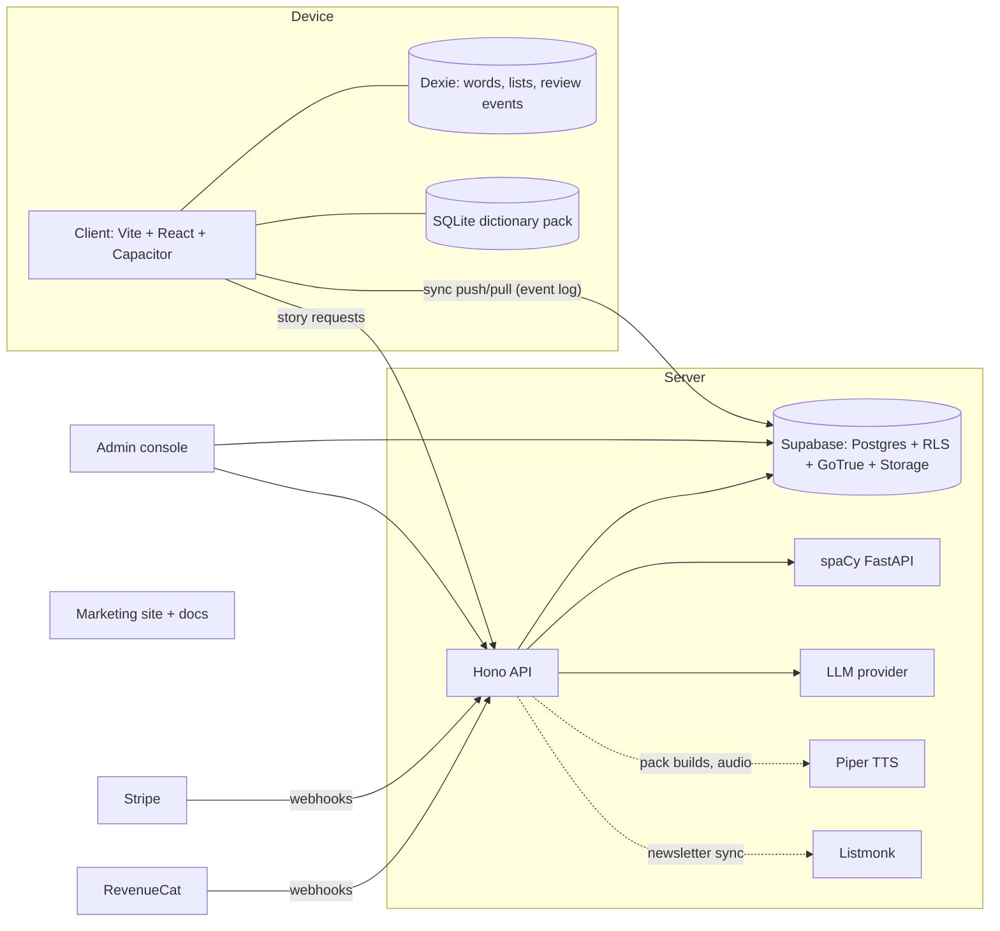

# Architecture

One self-hosted Supabase (Postgres, RLS, auth, storage), a small Hono API for everything that needs
secrets, a spaCy service for deterministic annotation, and an offline SPA packaged with Capacitor.

Everything runs behind Traefik on one Hetzner box; the web app, admin and site are static files.
