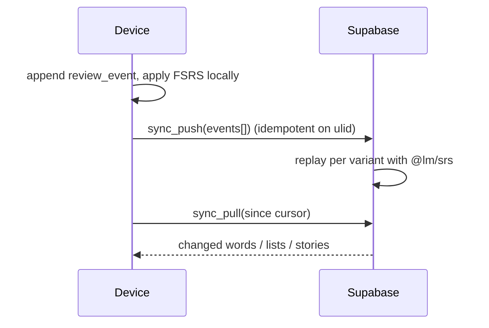

# Offline-first data model

Every review is an immutable event; card state is derived from events, so devices never fight
over a row.

1. **Events, not rows, for training.** `review_events(ulid, word_id, grade, reaction_ms, mode,
   reviewed_at, supersedes?)`. An override writes a new event with `supersedes = <old ulid>`;
   replay skips superseded events. Push is idempotent on the ulid.
2. **Derived state is a cache.** `card_state` on the device and `user_words.srs_*` on the server
   are recomputed from the log with the same `@lm/srs` code. If they disagree, replay wins.
3. **LWW only where it is safe.** Lists, memberships, settings and story metadata use
   `updated_at` + `deleted_at` tombstones.
4. **Pull by cursor.** `sync_pull(since)` returns rows with `updated_at > since`.
5. **Triggers.** Push on online, foreground, session end, every 5 minutes while active.

