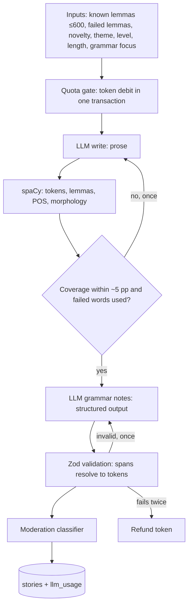

# Story pipeline

Two small LLM calls around a deterministic NLP pass. No free text from the learner reaches the
model: every input is an enum or a lemma list.

Cost per story at length 2 is roughly 0.01 €. Official texts skip the quota gate and the writer call.
As a last step the API voices every word form, sentence and the whole story through Piper and
ships the clips with the response, so a new story reads offline immediately.

Status: the pipeline and reader work; the generation screen states, archive limits by tier and a
rating loop are still open (see `docs/review-2026-11-06.md`).
